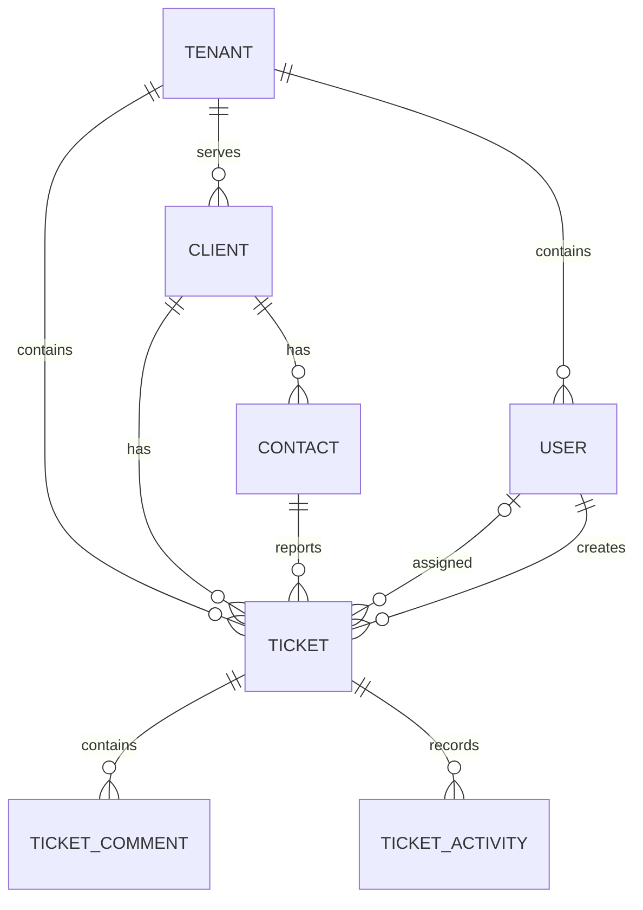

# HelpDesk — Project Plan

Last updated: 2026-10-08

This is the living planning document for HelpDesk. Confirmed requirements are separated from proposed implementation choices and open questions. Update this document as decisions are made.

## 1. Product Overview

HelpDesk is a multi-tenant SaaS ticket management platform for technical support organizations to track, manage, and resolve client issues.

Each tenant is a support organization using HelpDesk. Its clients are the people or businesses receiving its services. Internal support employees use the application; client contacts do not log in during V1.

## 2. Goals

- Make ticket creation quick and straightforward.
- Give technicians and managers a shared view of client issues and current responsibility.
- Support self-reliant teams through technician self-assignment.
- Preserve a useful record of work and ticket changes.
- Keep each tenant's data isolated.
- Build incrementally, using requirements and a data model before implementation.

## 3. Version 1 — MVP

### Authentication and users

- Login and logout.
- Internal user accounts with Administrator, Manager, and Technician roles.
- Administrator user management.
- One tenant per user in V1.

### Clients and contacts

- Create, view, and edit clients.
- Support both individual and business clients.
- Store one address per client.
- Maintain client contacts and identify the primary point of contact.
- View a client's tickets.

### Tickets

- Create, view, and edit tickets.
- Require a client and a contact belonging to that client.
- Assign tickets and allow technicians to claim unassigned tickets.
- Change status and priority.
- Edit the original description when clarification or correction is needed.
- Add internal comments and display ticket activity/history.
- Allow managers and administrators to delete tickets.

### Ticket dashboard

- All tickets, my tickets, and unassigned tickets.
- Filter by status, priority, and client.
- Search tickets.

Categories are proposed for V1; their scope and management permissions still need confirmation. Report access is defined below, but the specific reports and whether reporting ships in V1 remain undecided.

## 4. Users and Permissions

All permissions apply only within the user's tenant.

| Capability | Administrator | Manager | Technician |
| --- | --- | --- | --- |
| View all tenant tickets | Yes | Yes | Yes |
| Create and edit tickets | Yes | Yes | Yes |
| Edit ticket description | Yes | Yes | Yes |
| Add internal comments | Yes | Yes | Yes |
| Change ticket status and priority | Yes | Yes | Yes |
| Claim an unassigned ticket for self | Yes | Yes | Yes |
| Assign or reassign to another technician | Yes | Yes | No |
| Resolve or close an assigned ticket | Yes | Yes | Yes |
| Delete tickets | Yes | Yes | No |
| Manage clients and contacts | Yes | Yes | Undecided |
| Manage users | Yes | No | No |
| Manage organization settings | Yes | No | No |
| View reports, when available | Yes | Yes | No by default |

V1 uses three fixed roles. Authorization should check individual capabilities so custom roles and permissions can be introduced later. The implementation mechanism has not been selected.

Client contacts represent customer-side people and have no application access in V1.

## 5. Confirmed Business Rules

### Tenant isolation

- A user must never access another tenant's records.
- Ticket relationships must remain within the same tenant, including client, contact, assignee, creator, and category if implemented.

### Visibility and assignment

- Technicians can view every ticket within their tenant, regardless of assignment.
- Assignment indicates responsibility; it does not restrict visibility.
- Technicians can claim an unassigned ticket only for themselves.
- Technicians cannot take an already assigned ticket from another technician or assign it to someone else.
- Managers and administrators can assign and reassign tickets to technicians within the tenant.
- A technician can review, investigate, and comment on a ticket assigned to someone else.
- A ticket must have an assigned technician before it can be resolved or closed.
- Assignment and closure rules must be enforced server-side.

### Clients and contacts

- A client is an individual or business receiving services from the tenant.
- A client can have multiple contacts.
- A contact is a person associated with a client; the primary contact is the main point of contact.
- Every ticket must reference a contact.
- That contact must belong to the ticket's client and tenant.
- Tickets display current contact information from the contact record; historical contact snapshots are not required in V1.
- One client address is sufficient for V1.

### Descriptions and comments

- Technicians can edit a ticket's original description to correct or clarify the problem.
- The description states the problem; comments record investigation and work performed.
- Comments are internal-only in V1 and are authored by authenticated internal users.
- Comments are separate records rather than a single notes field on the ticket.

### Deletion and history — proposed implementation

- Implement ticket deletion as soft deletion to preserve history.
- Record description edits and significant ticket changes in activity history, including actor and timestamp.
- Preserve old and new description values when recording description edits.

These implementation proposals have not yet been explicitly confirmed.

## 6. Ticket Status and Priority

Proposed V1 statuses:

| Status | Meaning |
| --- | --- |
| Open | Newly reported issue that has not been worked |
| In Progress | A technician is actively working on the issue |
| Waiting on Client | Support needs information or action from the client |
| Resolved | Support believes the issue is fixed |
| Closed | The ticket is finished |

Proposed priorities: Low, Normal, High, Critical.

Status and priority are independent. A ticket may be Waiting on Client and Critical at the same time.

The typical workflow is Open → In Progress → Resolved → Closed, with movement between In Progress and Waiting on Client. The complete transition matrix, direct resolution rules, and reopening behavior remain undecided. Do not treat this typical path as the final set of allowed transitions.

## 7. Domain Model and Draft Data Dictionary

The following fields are a planning draft, not a finalized database schema. Data types, nullability, defaults, indexes, foreign keys, and deletion behavior will be defined next.

### Tenant

The support organization using HelpDesk.

Draft fields: `id`, `name`, `slug`, `active`, `created_at`, `updated_at`.

### User

An internal employee with application access, belonging to one tenant in V1.

Draft fields: `id`, `tenant_id`, `first_name`, `last_name`, `email`, `password_hash`, `role_id`, `active`, `created_at`, `updated_at`, `deleted_at`.

Password storage must use a secure hash. The framework's actual attribute names and role storage design remain to be selected.

### Role

Defines the capabilities available to a user. V1 roles are Administrator, Manager, and Technician. Roles apply within the user's organization. A dedicated role table versus fixed role definitions remains undecided.

### Client

An individual or business receiving support from a tenant.

Draft fields: `id`, `tenant_id`, `client_type`, `name`, `phone`, `email`, `address_line_1`, `address_line_2`, `city`, `state`, `postal_code`, `country`, `active`, `created_at`, `updated_at`, `deleted_at`.

One generic name supports either a business name or an individual's name. The address fields represent one address.

### Contact

A person associated with one client who can report issues.

Draft fields: `id`, `tenant_id`, `client_id`, `first_name`, `last_name`, `email`, `phone`, `job_title`, `is_primary`, `active`, `created_at`, `updated_at`, `deleted_at`.

The exact primary-contact requirement and uniqueness constraint are still to be decided.

### Ticket

One support issue for a client, reported through a required contact.

Draft fields: `id`, `tenant_id`, `ticket_number`, `client_id`, `contact_id`, `assigned_user_id`, `category_id`, `status`, `priority`, `subject`, `description`, `created_by_user_id`, `created_at`, `updated_at`, `resolved_at`, `closed_at`, `deleted_at`.

- Client and contact references are required.
- Assignment is optional until resolution or closure.
- Contact information is loaded from the current contact record.
- Proposed: use a human-facing ticket number separate from the database ID, unique within each tenant.
- Category is contingent on confirming categories for V1.

### Ticket Comment

An internal note about a ticket, separate from its description.

Draft fields: `id`, `tenant_id`, `ticket_id`, `user_id`, `body`, `created_at`, `updated_at`, `deleted_at`.

Comment editing and deletion permissions remain undecided. No client-visible comment fields are needed for V1.

### Ticket Activity

A system-generated record of significant ticket changes, separate from comments.

Draft fields: `id`, `tenant_id`, `ticket_id`, `user_id`, `activity_type`, `old_value`, `new_value`, `created_at`.

Proposed events include creation, assignment, reassignment, status changes, priority changes, description edits, category changes if categories are included, and comment changes. The exact payload format and event list remain undecided.

### Category — proposed

A tenant-specific classification such as Network, Hardware, Software, Email, Phone System, Accounts, Security, or Other.

Draft fields: `id`, `tenant_id`, `name`, `description`, `active`, `created_at`, `updated_at`.

## 8. Relationships

- A tenant has users, clients, tickets, and categories if included.
- A client belongs to one tenant and has many contacts and tickets.
- A contact belongs to one client and can be referenced by many tickets.
- A ticket belongs to one client and one contact.
- A ticket references its creator and optionally its assigned technician.
- A ticket has many internal comments and activity records.

Tenant ownership also applies to contacts, comments, and activity records. The diagram omits those ownership edges for readability. It does not replace the database constraints needed to prevent mismatched tenant or client references.

## 9. Application Architecture

Laravel and PostgreSQL are the working direction from planning. Exact versions, frontend approach, authentication setup, tenancy strategy, and application structure still need definition.

Plan authorization and business rules before controllers and screens. Enforce rules on the server and use database constraints where appropriate.

## 10. API

API scope and authentication are not yet defined. Decide whether V1 needs a separate API before documenting endpoints.

## 11. Security

Requirements established so far:

- Authenticate internal users.
- Enforce tenant isolation and permissions server-side.
- Validate related records against the tenant and the selected client.
- Store passwords as secure hashes.
- Keep internal comments inaccessible to clients.

Detailed security design will follow the architecture and schema decisions.

## 12. Testing

Plan meaningful checks for:

- Cross-tenant access and relationship rejection.
- Technician self-assignment versus manager reassignment.
- Two technicians attempting to claim the same unassigned ticket.
- Rejection of resolution or closure without an assignee.
- Required contact and contact/client consistency.
- Current contact information displayed on existing tickets.
- Description editing and internal comment behavior.
- Role permissions, including report access when reports are implemented.

The test framework and detailed test plan remain undecided.

## 13. Infrastructure and Deployment

Hosting provider, deployment process, environments, CI, backup strategy, and operational setup remain undecided.

## 14. Future Features

Outside the initial core scope:

- Client portal and client-visible conversations.
- Custom roles and permissions.
- Email integration and notifications.
- SLA tracking and overdue-ticket calculations.
- Advanced reporting.
- Teams and team-based routing.
- AI features and webhooks.
- Multiple client addresses.

Future ideas do not imply a commitment to implement them.

## 15. Development Roadmap

1. Define product and MVP — initial definition complete.
2. Define roles and business rules — core decisions complete; remaining questions below.
3. Define the PostgreSQL schema — initial implementation complete; review provisional defaults below.
4. Define application architecture and capability enforcement — next.
5. Set up the application and development environment.
6. Implement authentication, tenant isolation, and permissions.
7. Implement clients and contacts.
8. Implement ticket creation, assignment, and workflow.
9. Implement internal comments and activity history.
10. Implement dashboard filters and search.
11. Verify business rules and complete deployment documentation.

## 16. Open Questions and Decisions

Before finalizing the schema:

- Can technicians create or edit clients and contacts?
- Must each client always have exactly one primary contact, or may there be none?
- What name, email, and phone fields are required for clients and contacts?
- Confirm soft deletion and define restore permissions.
- Define what happens when referenced clients, contacts, users, or categories are deactivated or deleted.
- Define the full status transition matrix and reopening behavior.
- Can managers remove an assignee, and how should resolved or closed tickets behave if the assignee is deactivated?
- Define comment editing/deletion permissions and history behavior.
- Confirm description change history and which old/new values are retained.
- Confirm categories and their management permissions.
- Confirm tenant-scoped ticket numbering and its format.
- Decide email uniqueness scope and tenant identification during login.
- Decide whether reports are part of V1 and, if so, which reports.

### Confirmed decision log — 2026-10-08

| Decision | Outcome |
| --- | --- |
| Technician visibility | All tickets within the tenant |
| Technician assignment | Claim unassigned tickets for self only |
| Manager deletion | Managers may delete tickets |
| Completion requirement | An assignee is required before resolution or closure |
| Technician report access | Disabled by default; custom permissions may be added later |
| Ticket contact | Required and must belong to the selected client |
| Contact information | Always display current contact data |
| Client addresses | One address in V1 |
| Ticket descriptions | Technicians may edit after creation |
| Comments | Internal-only in V1 |

## 17. Initial PostgreSQL Implementation

The executable schema is in [`database/migrations/001_initial.sql`](../database/migrations/001_initial.sql). Setup instructions, runtime security requirements, and provisional decisions are in [`database/README.md`](../database/README.md). Database checks are in [`database/tests/schema.sql`](../database/tests/schema.sql).

Implemented: seven core tables, composite tenant/client foreign keys, row-level tenant security, internal comments, tenant-specific numbering, completion constraints and timestamps, ticket history, soft-delete fields, and dashboard/search indexes.

Provisional implementation defaults, pending product confirmation:

- Fixed role values; application policies will expose individual capabilities.
- Proposed statuses and priorities; no transition matrix yet.
- Soft deletion and before/after ticket snapshots, including description changes.
- At most one active, nondeleted primary contact per client; none is permitted.
- Required client name/type and contact/user first and last names; client/contact email and phone optional.
- Case-insensitive user email uniqueness within a tenant, reserved after soft deletion; identify the tenant before login.
- Integer ticket numbers allocated atomically within each tenant; display formatting deferred.
- Existing references survive deactivation/soft deletion; referenced records cannot be hard-deleted.
- Existing assignees remain on completed tickets after user deactivation; reopening clears current completion timestamps while preserving history.
- Categories deferred until confirmed.

Role authorization, new-reference eligibility, comment mutation history, provisioning/login access, restore permissions, and concurrent technician claim integration remain application work. These defaults do not add to the confirmed decision log. The uppercase `PROJECT_PLAN.md` is the current plan; lowercase `project_plan.md` remains historical.
