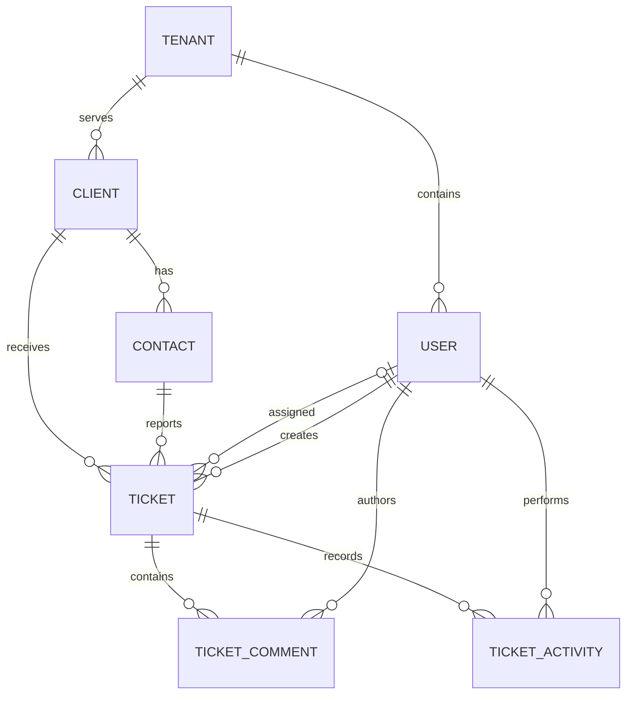

# HelpDesk — Project Plan

Last updated: 2026-10-26

This is the authoritative product and implementation plan. The older lowercase `project_plan.md` is historical. The PostgreSQL migration is the authority for database behavior; this plan also describes application behavior that has not been built yet.

**Decision labels:** **Confirmed** comes from prior discussion. **Implemented** describes existing repository artifacts, not a finished application. **Working default** is an engineering/product recommendation that allows planning to proceed and may be revised. **Pending answer** identifies a question currently with the owner. Working defaults are not retroactive user approvals.

## 1. Product and outcome

HelpDesk is a multi-tenant support application. A tenant is a support organization; its clients are businesses or individuals receiving support. Internal employees log in. Client contacts are customer-side people and do not have accounts in V1.

The first usable release lets an organization maintain clients/contacts, record issues, share responsibility, and preserve the investigation and change history. A technician sees all tickets in their tenant, claims unassigned work, records internal comments, and progresses issues to completion. Managers coordinate assignments. Administrators also manage employees and organization settings.

Success means a new organization can be provisioned, its administrator can add employees and clients, and a ticket can be created, claimed, investigated, resolved, closed, and reviewed without losing history or exposing another tenant's data.

## 2. Current repository status

| Artifact | Status | Meaning |
| --- | --- | --- |
| Product requirements and initial decisions | Documented | Confirmed rules are retained below |
| PostgreSQL domain schema | Implemented | Seven tables, constraints, indexes, triggers, tenant policies |
| Database checks | Implemented; previously passed on PostgreSQL 17 | Constraints, audit behavior, and non-owner RLS checks |
| Laravel application and frontend | Not started | No application scaffold or dependency manifests |
| Authentication and capability policies | Not started | Database role values are not application authorization |
| Deployment, CI, backups, and production provisioning | Not started | Requirements and gates are defined in this plan |

Existing files:

- [`database/migrations/001_initial.sql`](../database/migrations/001_initial.sql): initial schema.
- [`database/tests/schema.sql`](../database/tests/schema.sql): disposable database checks.
- [`database/README.md`](../database/README.md): SQL setup, context, runtime privileges, and query examples.

The schema does not by itself implement a usable or production-ready SaaS application.

## 3. Release scope

### V1 core

- Tenant-aware employee login/logout and account recovery.
- Administrator employee management with fixed Administrator, Manager, and Technician roles.
- Clients of type individual or business, one address per client, and multiple contacts.
- Optional primary contact, required ticket contact, and current contact information on ticket pages.
- Ticket creation/editing, editable descriptions, status/priority, assignment, and self-claim.
- Internal comments and ticket activity/history.
- Soft deletion of tickets by administrators/managers and a restricted restoration view.
- Dashboard views for all tickets, my tickets, and unassigned tickets; filters, search, and pagination.
- Minimal organization settings: display name; tenant slug changes reserved for controlled provisioning.
- Automated verification of tenant isolation, authorization, assignment races, and core workflows.

### Working default: later releases

Categories and reports are pending the owner's scope answer. The plan currently defers them. Attachments, public registration, billing/subscriptions, client portals, email-to-ticket, outbound ticket notifications, SLAs, teams, custom roles, multiple addresses, AI features, integrations, and public APIs are outside V1.

Account-recovery email is infrastructure for authentication and is separate from deferred ticket email integration. If outbound email is unavailable in a development environment, use a local mail sink; production recovery must work before release.

## 4. Roles and capability model

**Confirmed:** one tenant per employee; three fixed roles; authorization should use capabilities so custom permissions can be introduced later.

Implement Laravel policies/gates with a centralized capability map. Controllers, actions, and UI consult the same capabilities. Hidden buttons never substitute for server-side checks. The initial schema uses `users.role`, not a roles table.

| Capability | Administrator | Manager | Technician |
| --- | --- | --- | --- |
| View all live tenant tickets and current client/contact details | Yes | Yes | Yes |
| Create/edit tickets and original descriptions | Yes | Yes | Yes |
| Add internal comments | Yes | Yes | Yes |
| Change status/priority; resolve/close assigned tickets | Yes | Yes | Yes; workflow question below |
| Claim unassigned ticket for self | Yes | Yes | Yes |
| Assign/reassign to another eligible employee | Yes | Yes | No |
| Remove assignment from unfinished ticket | Working default: yes | Working default: yes | No |
| Soft-delete tickets | Yes | Yes | No |
| View deleted tickets and restore them | Working default: yes | Working default: yes | No |
| Create/edit clients and contacts | Yes | Yes | Yes |
| Deactivate/restore clients and contacts | Yes | Yes | No |
| Manage users/roles | Yes | No | No |
| Manage organization settings | Yes | No | No |
| Edit/delete posted comments | Deferred by default | Deferred by default | Deferred by default |
| View reports if introduced | Yes | Yes | No by default |

Technical defaults: all three roles have the capability to work tickets and may self-claim. Assignment targets are active, nondeleted employees with that capability. If assignment must be limited strictly to the Technician role, adjust eligibility before the ticket-assignment milestone.

Users cannot change their own tenant, promote themselves through profile editing, or disable/demote the last active administrator. Last-administrator checks must serialize concurrent changes, not merely count before saving.

## 5. Confirmed business rules

- All records and relationships stay within one tenant. A valid ID from another tenant never grants access.
- Every technician can see all live tickets in their tenant. Assignment indicates responsibility, not visibility.
- Technicians can claim an unassigned ticket only for themselves. They cannot take another person's assigned ticket, reassign to someone else, or delete tickets.
- Managers/administrators may assign and reassign work within their tenant.
- Every resolved or closed ticket must have an assignee.
- A ticket requires a client and a contact belonging to that client and tenant.
- A client may have multiple contacts and one address. Client contact records have no V1 login.
- Ticket pages show current contact information; historical contact snapshots are not required.
- Technicians may correct the original description. Comments record investigation/work and are internal only.
- Assignment, completion, and permissions must be enforced on the server.

## 6. Workflow, assignment, and concurrency

### Status and priority defaults

The schema implements these proposed values:

| Stored status | Display label | Meaning |
| --- | --- | --- |
| `open` | Open | Newly reported issue |
| `in_progress` | In Progress | Investigation/work underway |
| `waiting_on_client` | Waiting on Client | Customer information/action needed |
| `resolved` | Resolved | Support believes the issue is fixed |
| `closed` | Closed | Work is finished |

Priorities are `low`, `normal`, `high`, and `critical`; default is `normal`. Priority and status are independent.

**Pending answer / working default:** all three roles may change any live ticket to any listed status. Completion always requires an assignee. Assignment does not itself change status. Reopening means changing resolved/closed to open, in progress, or waiting on client. There is no mandatory linear transition matrix. A same-status save creates no status-change event.

### Assignment operations

Use separate actions for claim, manager assignment, and unassignment; do not allow a generic ticket update to bypass these rules.

- Claim: derive actor/tenant from authentication, require a live unassigned ticket and active actor, and use one conditional UPDATE. Exactly one successful claimant; a loser receives a friendly conflict and the current assignee.
- Reassign: authorize manager/administrator, validate the target in the tenant, lock the ticket row, then save and audit in one transaction.
- Unassign: working default permits managers/administrators on unfinished tickets. For resolved/closed tickets, require reopening in the same authorized transaction before clearing assignment.
- Completion: lock/recheck the current ticket and assignee; do not trust values from an old browser form.
- Inactive/deleted assignees remain visible historically. Unfinished work should be reassigned by a manager; a deactivated user cannot log in or receive new assignments.

Use row locking or conditional updates against an expected version for concurrent writes. A working default for stale form submissions is an optimistic comparison against the originally loaded `updated_at`, performed atomically before changing the row. A conflict prompts reload rather than silently overwriting another employee's work.

### Completion timestamps

Implemented triggers fill `resolved_at` for resolved/closed tickets and `closed_at` for closed tickets. Reopening clears current completion timestamps; previous values remain in ticket history. Application forms must not accept user-supplied completion timestamps, creator, tenant, identity, or ticket number.

## 7. Clients, contacts, and validation

Working defaults align with the existing schema:

| Entity | Required input | Optional input |
| --- | --- | --- |
| Tenant | Name, URL-safe unique slug during provisioning | None for initial setup |
| User | First/last name, tenant-unique email, role, secure password setup | Remember-me preference |
| Client | Name, type (`individual` or `business`) | Email, phone, one address |
| Contact | Client, first/last name | Email, phone, job title, primary flag |
| Ticket | Client, matching contact, subject, description | Assignee; status/priority have defaults |
| Comment | Ticket and nonblank body | None |

Validation trims ordinary surrounding whitespace, rejects blank required strings, validates supplied emails/country codes, and preserves phone/postal formatting. Require a reasonable request-size limit; initial application limits: names/subject 255 characters, email 254, phone 50, address fields 255, postal code 32, description 50,000, comment 20,000. These are working application limits, not existing SQL column limits. Store/render descriptions and comments as escaped plain text in V1.

Primary contacts: zero or one active, nondeleted primary contact per client. Changing primary is transactional: clear the old flag and set the new one; the partial unique index protects races. Deactivation removes a contact from active-primary eligibility but does not choose a replacement automatically.

New tickets and changed relationships may only select active, nondeleted clients/contacts. Existing tickets remain readable when their client/contact becomes inactive. Do not block an unrelated ticket edit merely because a preserved historical relationship is inactive. Existing contacts cannot be moved between clients; create the correct contact and explicitly change the ticket relationship instead. Changing a ticket's client requires selecting a valid contact for the new client in the same transaction.

## 8. Deletion, restoration, and history

**Implemented / working default:** use `deleted_at` for soft deletion. Normal queries exclude deleted records. Tickets retain their comments and activities when deleted. Deleted-ticket views and restoration require explicit capability checks; technicians cannot reach them through direct URLs.

- No ordinary UI permanently deletes tenants, users, clients, contacts, tickets, comments, or activity.
- Client/contact deactivation is preferred to removal. Existing references remain readable with an inactive label.
- User deactivation revokes further application access, preserves attribution, and does not erase assignments.
- Restoring a client/contact must revalidate primary-contact uniqueness. Restoring a user keeps its reserved email; administrator review controls activation.
- Tenant deactivation blocks all employee access without deleting data. Provisioning/operations control reactivation.
- Restored tickets retain their prior status and assignment unless an authorized user explicitly changes them.

The ticket audit trigger records creation and meaningful ticket updates, including before/after descriptions, assignment, status, priority, soft deletion, and restoration. It requires an active actor in the tenant. `created` and `updated` are stored activity types; the UI derives field-specific labels by comparing snapshots. Avoid recording duplicate application events for the same SQL-triggered change.

Working default: posted comments cannot be edited or deleted in V1; users add a correcting comment. The existing schema permits storage for later comment mutation but has no comment-history trigger. If editing/deleting comments is requested, design its authorization and history before exposing it.

Activity is internal and contains potentially sensitive prior descriptions. Do not copy full snapshots or comment text into application logs. Activity update/delete triggers are safeguards, not a tamper-proof audit system against a privileged database operator or compromised application.

## 9. Database model and ownership

All primary keys are bigint identities generated by PostgreSQL. Timestamps are timezone-aware; store instants consistently and display them in the user's/browser's chosen timezone, using UTC as the fallback. The following reflects the current schema, replacing the earlier draft field names:

| Table | Main fields and responsibility |
| --- | --- |
| `tenants` | `id`, `name`, `slug`, `active`, `next_ticket_number`, timestamps |
| `users` | Tenant, first/last name, `email`, hashed `password`, fixed `role`, active flag, `remember_token`, timestamps/deletion |
| `clients` | Tenant, type/name, email/phone, address, active flag, timestamps/deletion |
| `contacts` | Tenant/client, names, email/phone/job title, primary/active flags, timestamps/deletion |
| `tickets` | Tenant, generated tenant-specific number, client/contact, assignee/creator, status/priority, subject/description, lifecycle timestamps |
| `ticket_comments` | Tenant/ticket, author (`user_id`), body, timestamps/deletion |
| `ticket_activities` | Tenant/ticket, actor (`user_id`), `activity_type`, JSONB `old_values`/`new_values`, creation time |

There is no `roles` or `categories` table and no `category_id` field in the initial schema. There is no `password_hash` attribute; Laravel stores its secure hash in `password`. There are no historical contact snapshots.

Every domain table is tenant-scoped, directly or through the tenant's own ID. Composite foreign keys enforce tenant/client consistency. Ticket numbers start at 1 per tenant; format as `HD-000001` in the UI as a working default, without storing the prefix/padding. Larger numbers expand naturally; never reset/reuse numbers. Number allocation serializes ticket creation per tenant; acceptable for the initial release, subject to measurement.

Tenant-first indexes cover filters, assignments, relationships, and timelines. The English full-text index searches ticket subjects/descriptions; it does not search comments or provide arbitrary substring matching. Search by an exact number should use the number index. Add indexes only when actual query plans justify them.

## 10. Application architecture

**Working implementation direction:** one Laravel application with a server-rendered Blade frontend, Livewire for interactive forms/filters, and Tailwind CSS for styling. PostgreSQL 17 remains the database target. Use Laravel policies, Form Requests or equivalent server validation, Eloquent models, and small domain action classes. Avoid a separate SPA/API and microservices for V1.

At scaffolding, verify and pin a compatible supported Laravel/PHP/Livewire toolchain, commit dependency lockfiles, and document exact versions in the root README. This plan does not claim versions have already been installed. Use PHPUnit through Laravel's testing facilities; select one test style and apply it consistently.

Suggested responsibilities:

- Middleware resolves tenant context, authenticates, checks active status, and establishes transaction-local database context.
- Policies/gates answer capability questions; they do not perform writes.
- Controllers/Livewire components handle requests, validation results, and presentation.
- Actions such as `CreateTicket`, `ClaimTicket`, `AssignTicket`, `ChangeTicketStatus`, `DeleteTicket`, `RestoreTicket`, and `SetPrimaryContact` own transactions and invariants.
- Models define tenant-scoped relationships, casts, and soft-delete scopes. Explicitly allowlist writable fields.
- Database constraints/triggers provide the final relationship/completion checks and ticket history.

Do not scatter role-name comparisons through controllers and templates. Do not accept model IDs without tenant-scoped resolution. Refresh trigger-modified fields after writes before displaying ticket numbers or timestamps.

### Migration integration

Adopt the existing SQL once through a versioned Laravel migration, removing its outer BEGIN/COMMIT if the migration runner manages the transaction. Do not also create Laravel's default users table. Preserve constraints, triggers, policies, and ALWAYS identity semantics. Document rollback as destructive and available only for disposable development databases; production changes use forward migrations.

Framework tables for sessions, password-reset tokens, jobs/cache, and migration tracking are additional infrastructure, not part of the seven-table domain model. Plan their tenant/credential handling before enabling features. Prefer file sessions/cache for single-instance local development; production session storage and scaling need explicit configuration.

## 11. Tenancy, authentication, and security implementation

### Tenant routing and bootstrap

Working default routes live under `/t/{tenant_slug}`. Login uses the organization slug plus email/password; the same email may exist in different tenants. Do not offer public tenant creation in V1. Provision tenants and their first administrator using a controlled CLI command, with no default/shared passwords.

The current RLS design cannot resolve an unknown tenant ID from its slug through the ordinary tenant policy. Implement and test a narrowly scoped tenant lookup function returning only ID and active status for an exact slug. If using SECURITY DEFINER, use a dedicated least-privilege owner, fixed safe search path, qualified objects, restricted EXECUTE grants, and no general table-write/admin privileges. The migration or maintenance superuser must never be the web connection. This is a required implementation task, not an existing function.

### Request sequence

1. Resolve the tenant from the route through the restricted lookup path; provide generic failures and rate limits to reduce tenant/account enumeration.
2. Start the domain transaction on the runtime connection; set `app.tenant_id` locally before fetching tenant/user/domain rows.
3. Authenticate/reload the session user inside that tenant. Verify active tenant, active/nondeleted user, and session tenant match. Bind authenticated identity to the session; switching the slug must never change a logged-in user's tenant.
4. Set `app.user_id` from the authenticated user before any ticket write; perform policy checks before actions.
5. Commit only successful operations; roll back failures. Never stream/lazily load protected rows after the context transaction ends.

Ensure route-model binding and Livewire requests run after context establishment. Reestablish context for every request and every job; never rely on connection state from a prior request. Keep outbound email/network calls outside transactions and dispatch only after commit.

### Authentication lifecycle

Use framework password hashing, session regeneration on login, CSRF protection, login/recovery rate limiting, secure cookies under HTTPS, generic invalid-credential responses, and session invalidation on logout. Disable authentication for deactivated tenants/users on every request, not just at login. Use server-rendered escaped output and parameterized database queries.

Password recovery must be tenant-scoped. Default reset-token storage keyed only by email is insufficient when emails repeat across tenants; include tenant identity in token lookup/storage and reset links, expire/single-use tokens, and test cross-tenant token rejection. Provision new users with a one-time password-setup flow using that mechanism. In development, inspect setup mail in the mail sink rather than exposing links to ordinary users.

### Database and application boundaries

Runtime uses a non-owner, non-superuser role without BYPASSRLS, DDL, TRUNCATE, or hard-delete grants. Forced RLS denies access when tenant context is missing. A separate provisioning/migration identity performs controlled setup/maintenance. Grant only the table, sequence, and function privileges needed; the current invoker audit trigger needs activity INSERT permission.

RLS enforces tenant boundaries; policies enforce capabilities, active-record eligibility, and field-level restrictions. Do not mass-assign `tenant_id`, IDs, ticket number, creator, role, timestamps, or password fields from a generic form. Tenant context is trusted server state, not a browser-controlled permission.

## 12. Screens and user journeys

| Screen | Required behavior and acceptance |
| --- | --- |
| Tenant login/recovery | Slug-aware login; clear validation; generic authentication errors; safe redirects |
| Ticket dashboard | All/My/Unassigned views, live tickets, filters/search, pagination, newest first |
| New ticket | Active client picker, dependent contact picker, subject/description, priority, authorized assignment |
| Ticket detail | Number, status, priority, current client/contact, assignee/creator, description, internal comments, activity |
| Edit ticket | Preserve input on validation errors; stale-write conflict; dependent client/contact validation |
| Clients | Search/list, create/edit as authorized, type/active status, client detail and ticket list |
| Contacts | Manage from client detail; optional primary contact; no cross-client selection |
| User administration | Administrator-only create/update/deactivate; role validation; last-admin protection |
| Organization settings | Administrator-only name update; slug and counter are not editable here |
| Deleted tickets | Manager/admin-only list/detail/restore; no technician access |

Creation journey: employee chooses client → contact list updates → employee enters subject/description → save returns assigned ticket number and creation history. If no suitable contact exists, an authorized user adds one; the required-contact rule is never bypassed.

Work journey: technician opens unassigned queue → claims ticket → changes status → adds internal investigation comments → resolves/closes once assigned. Other technicians can still review and comment.

Dashboard filters combine with AND; tabs add their assignment condition. Default sort is creation descending with ID as a deterministic tie-breaker. Working default page size is 25, capped at 100. Preserve filters in the URL. Search recognizes a plain/formatted exact ticket number and otherwise searches subject/description. Use allowlisted sort/filter values and debounce interactive search.

Provide loading, empty, validation, forbidden/not-found, and conflict states; keyboard-accessible labels/focus, status text beyond color, and usable layouts on desktop/mobile. Show cross-tenant record lookups as not found without revealing ownership.

## 13. HTTP/application interface

V1 serves authenticated browser routes, not a public API. Proposed route families under `/t/{tenant_slug}`:

| Route/action family | Responsibility |
| --- | --- |
| Login/logout/recovery | Guest/session lifecycle with tenant context |
| `/tickets`, `/tickets/create`, `/tickets/{ticket}` | List, create, read, authorized edit |
| Ticket claim/assignment/status/comment actions | Dedicated authorized mutations |
| Ticket delete/restore and deleted-ticket list | Restricted soft-delete lifecycle |
| `/clients`, `/clients/{client}` and nested contacts | Client/contact management |
| `/admin/users` | Administrator employee management |
| `/admin/settings` | Organization settings |

Use GET only for reads, POST for creation/actions, PATCH for updates, and DELETE for soft deletion when using conventional controllers. All browser mutations require CSRF protection. Livewire actions must apply the same policies and validation as controller actions; neither route style may bypass domain actions.

## 14. Test and validation plan

Use real PostgreSQL 17 for database/feature/integration tests; SQLite cannot validate this RLS/trigger design. Exercise production-like non-owner credentials as well as a separate migration/test-maintenance identity. Keep test data synthetic.

| Area | Required evidence |
| --- | --- |
| Tenant isolation | A/B fixtures; direct URLs, lists, search, relationships, Livewire requests, missing context, reused connection, and background jobs cannot leak data |
| Authentication | Tenant-scoped duplicate emails, invalid credentials, deactivation, logout, CSRF, session tenant mismatch, recovery token isolation |
| Roles | Every capability allowed/denied per matrix, including forged assignment/role/tenant fields and deleted-ticket access |
| Clients/contacts | Required fields, dependent picker, cross-client contact rejection, primary-contact race/restore conflict, current contact information on old tickets |
| Assignment | Self-claim only; no technician reassignment; manager reassignment; inactive target rejection; two concurrent claims yield one winner |
| Workflow | Every proposed transition, completion without assignee rejected, unassignment/completion race, reopen timestamps, inactive historical assignee behavior |
| History | Description before/after, actor, creation, reassignment, deletion/restoration; transaction rollback leaves no partial audit |
| Edits/comments | Blank input rejection, escaped output, no generic-field bypass, stale-write conflict, no comment mutation UI |
| Queries | All/My/Unassigned, combined filters, exact-number/full-text search, pagination, no deleted rows, deterministic ordering |
| Operations | Fresh install, controlled provision, migration failure, production-role grants, backup restore, tenant-disabled access |

Existing SQL checks remain an independent guard. Integration tests for races must use separate connections/processes and committed fixtures; a single test transaction is insufficient. Run browser smoke checks for the main creation/work/admin journeys and basic accessibility.

Definition of done for each implementation slice: authorized behavior works, denial paths are tested, tenant context is correct, no unrelated scope is added, relevant checks pass, and setup/documentation reflect the result.

## 15. Development workflow and CI

Working default local setup: Docker Compose with application/PHP tooling, PostgreSQL 17, and a development mail sink. Bind local services appropriately; no committed credentials. A root README will document installation, migrations, provisioning, assets, test commands, and troubleshooting once scaffolded. Provide `.env.example` with safe placeholders and committed Composer/npm lockfiles.

CI should run on proposed changes: install locked dependencies, check formatting/static analysis, build frontend assets, create a fresh PostgreSQL database, migrate/provision fixtures, run SQL and application tests, and exercise non-owner runtime credentials. Do not substitute a superuser connection for RLS assertions. Add browser checks after the first vertical slice exists. Test migration from the last release before production database changes.

Use small commits tied to milestones. Keep migration changes versioned; once applied to shared environments, add follow-up migrations instead of editing history. No production data in fixtures or logs.

## 16. Delivery roadmap and acceptance gates

No calendar estimate is committed before the first slice establishes the development workflow. Execute these in order; each gate is reviewable independently.

| Milestone | Deliverables | Exit condition |
| --- | --- | --- |
| M0: planning/schema baseline | Current plan, seven-table schema, documented assumptions | Existing SQL checks pass; product questions tracked |
| M1: runnable foundation | Laravel/Blade/Livewire scaffold, pinned dependencies, Compose, migration adoption, README, CI skeleton | Fresh checkout boots; schema applies once; SQL tests pass on PostgreSQL |
| M2: tenant/auth/security foundation | Tenant lookup/provision CLI, runtime grants, context middleware, login/logout/recovery, policies, two-tenant fixtures | Non-owner isolation tests pass; inactive accounts/tenants blocked; reset flow tenant-safe |
| M3: employees and clients | Administrator user management, last-admin protection, client/contact forms, primary contact | Tenant A administrator creates employee/client/contact; tenant B cannot see them |
| M4: first ticket slice | Ticket create/list/detail/edit, contact dependency, numbering, displayed audit history | Authenticated user creates a ticket and sees its number/current contact/history |
| M5: work lifecycle | Atomic self-claim, manager assignment, status/priority, comments, conflicts, soft-delete/restore | Concurrent claims yield one winner; complete/reopen/delete/restore flows pass role tests |
| M6: dashboard and usability | All/My/Unassigned, filters, number/full-text search, pagination, responsive states | Main browser journeys pass with realistic synthetic data and bounded queries |
| M7: release preparation | Staging deploy, mail/session config, monitoring, backup/restore, runbook | Release gates below pass; owner accepts staging workflow |

### First development session: M1 tasks

1. Confirm available PHP/Composer/Node/Docker tooling and pin a compatible application toolchain.
2. Scaffold the application without replacing the existing plan or database files.
3. Reconcile framework authentication/infrastructure tables with the domain schema before running default migrations.
4. Add a migration wrapper for the SQL baseline and a safe development provisioning path.
5. Boot the application and PostgreSQL; run the SQL suite on a disposable database.
6. Add the root README, example environment, reproducible commands, and initial CI job.
7. Open the initial browser page and verify the project can be started again from the documented steps.

M1 can begin while product answers are pending. Do not ship affected capability/workflow paths until their answers or explicitly accepted defaults are recorded.

## 17. Deployment and operations

Working default deployment topology: one Laravel application instance and a backed-up PostgreSQL service. Provider/region/domain and budget are owner decisions before staging, not prerequisites for local development. Use separate development, staging, and production configurations and credentials.

Deployment sequence: build locked assets/dependencies → take/verify a pre-migration backup where warranted → run migrations with the migration identity → deploy app with runtime identity → health/smoke checks → observe errors. Do not leave the migration credential in the web process. Roll back application code only when compatible with the database; database recovery uses a reviewed forward fix or tested restore, never blind rollback of production tables.

Require HTTPS, secure session cookies, debug disabled, secret management, application key protection, database access restricted to intended services, and redacted structured logs. Use a health check for application/database readiness that does not disclose tenant data. Monitor HTTP errors, failed jobs if queues are enabled, database availability/storage, failed backups, and unusual authentication failures.

Initial backup target recommendation: encrypted daily backups, 30-day retention, and restore verification before release; target recovery point of 24 hours and recovery time of 4 hours, subject to owner/provider confirmation. These are acceptance targets, not current guarantees. A single-database restore affects all tenants; tenant-specific recovery and data export need deliberate procedures.

Document provisioning/deactivation, recovery, failed migration, backup restoration, secret rotation, and reassignment after employee departure. Add a queue worker only when asynchronous work requires it; every job carries explicit tenant/actor identity and establishes fresh context. Data retention, permanent erasure, and customer offboarding requirements must be decided before accepting real customer data.

## 18. Release acceptance

V1 is ready when:

- A fresh checkout starts using documented commands with no hidden manual database edits.
- A controlled operator provisions an organization and administrator without shared/default credentials.
- Administrator creates an employee; a client/contact and ticket are created; technician claims, comments, resolves/closes; manager reassigns and deletes/restores.
- The same workflows work independently for a second tenant with overlapping employee emails.
- Capability, RLS, recovery, concurrency, stale-write, and audit tests pass using production-like roles.
- Search/filter/pagination and inactive/deleted-record behavior match this plan.
- Staging mail, HTTPS/session handling, logging, health checks, backup restoration, and deployment runbook are verified.
- Owner reviews the pending product decisions, remaining limitations, and staging workflow before production publication.

## 19. Decisions requiring owner input

### Current product questions

| ID | Question | Recommended working default | Affected work |
| --- | --- | --- | --- |
| Q1 — confirmed | Can technicians create/edit clients and contacts? | Yes; only managers/admins deactivate/restore | M3 policies and controls |
| Q2 | Who can resolve, close, and reopen tickets? | Any internal employee on any live tenant ticket; completion needs an assignee; any listed status transition allowed | M5 policies/workflow |
| Q3 | Include categories/reports/comment editing in first release? | Defer categories and reports; comments append-only | M3–M6 scope/schema |

Answers override the corresponding working defaults throughout this plan. If categories/reports are included, define category management, report measures, filters, and access before adding schema/UI.

### Defaults available for review; do not block scaffolding

Soft deletion with manager/admin restoration; optional primary contact; optional client/contact email/phone; names required; tenant-scoped case-insensitive user email; integer numbering displayed as `HD-000001`; current contact information; preserved inactive historical relationships; ticket snapshot history; eligible assignees include all ticket-working roles; server-rendered Laravel/Livewire frontend; no public API/registration.

### Needed before production

Hosting/provider/budget/region/domain; outbound recovery mail; backup/recovery targets; retention/permanent-erasure obligations; operational owner and support process. Record decisions when made rather than presenting a recommendation as a confirmed requirement.

## 20. Confirmed decision record

| Source | Decision |
| --- | --- |
| Prior product discussion | Tenant is a support organization; clients/contacts receive its services |
| Prior product discussion | Internal employees only; one tenant per employee; three fixed roles |
| Prior product discussion | Technicians see all tenant tickets and claim only unassigned tickets for themselves |
| Prior product discussion | Managers/admins may reassign; managers may delete tickets |
| Prior product discussion | An assignee is required before resolution/closure |
| Prior product discussion | Every ticket has a matching client/contact; show current contact data |
| Prior product discussion | One client address; editable original descriptions; internal-only separate comments |
| Prior product discussion | Technician report access disabled by default; future custom permissions possible |
| Owner answer, 2026-10-26 | Technicians may create/edit clients and contacts; only managers/admins deactivate or restore them |
| Schema work | PostgreSQL baseline and checks implemented; Laravel application remains to be built |
| Git upload request | Baseline plan/schema/setup notes/tests uploaded to repository `main` in commit `7f46fd0` |

Additional product confirmations will be added here after the owner answers. Code existence and prior upload do not imply confirmation of every provisional product default.
